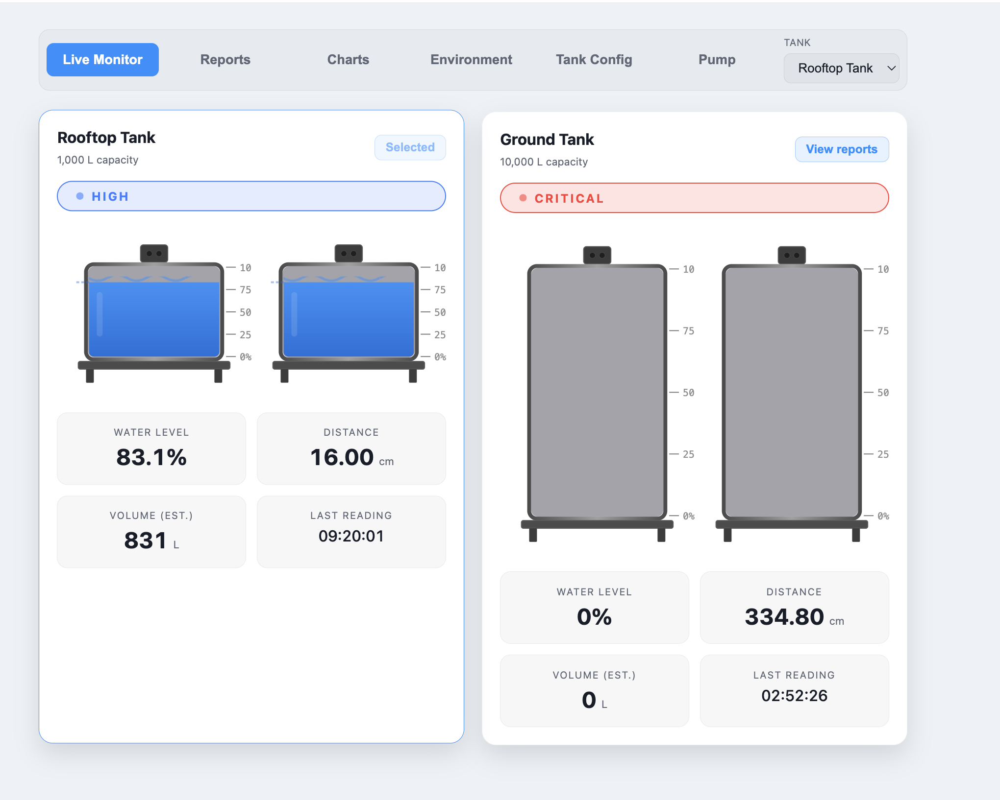
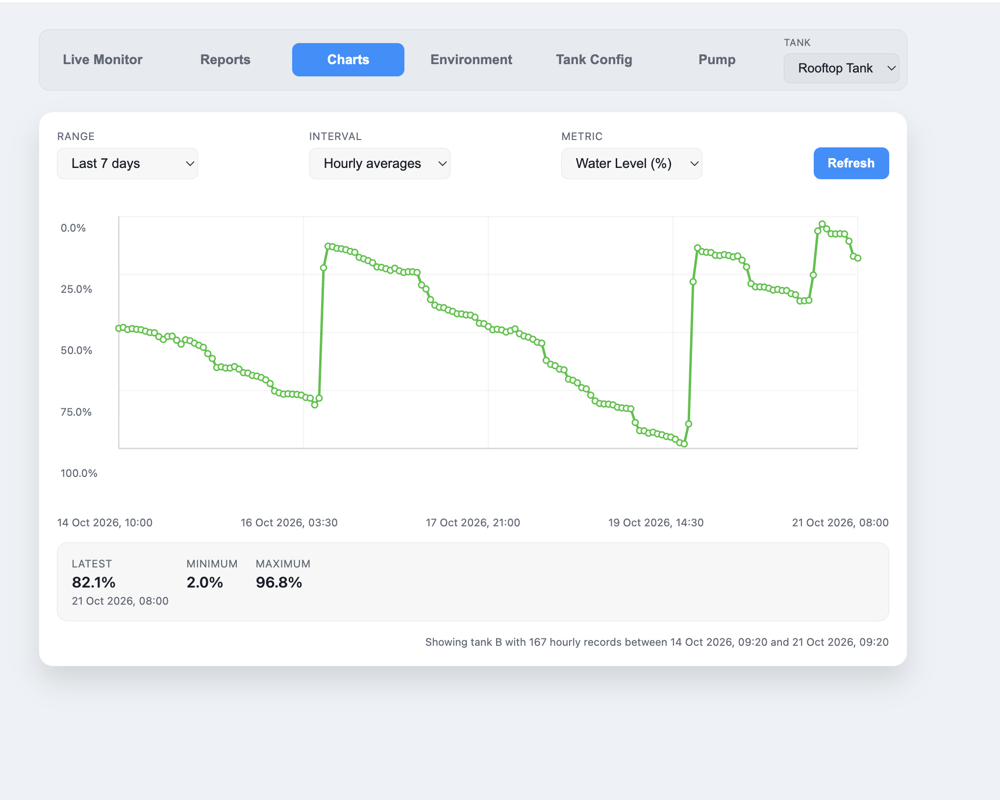
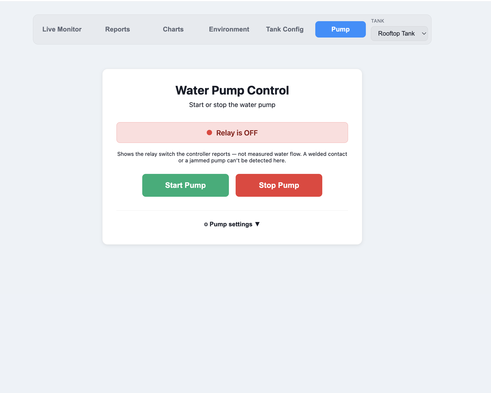

# IoT Water Monitor

A React + Go water-monitoring dashboard with JWT authentication and role-based access.

## Live Monitor

## Charts

## Pump Control

[Setup and authentication details](docs/guide.md)
